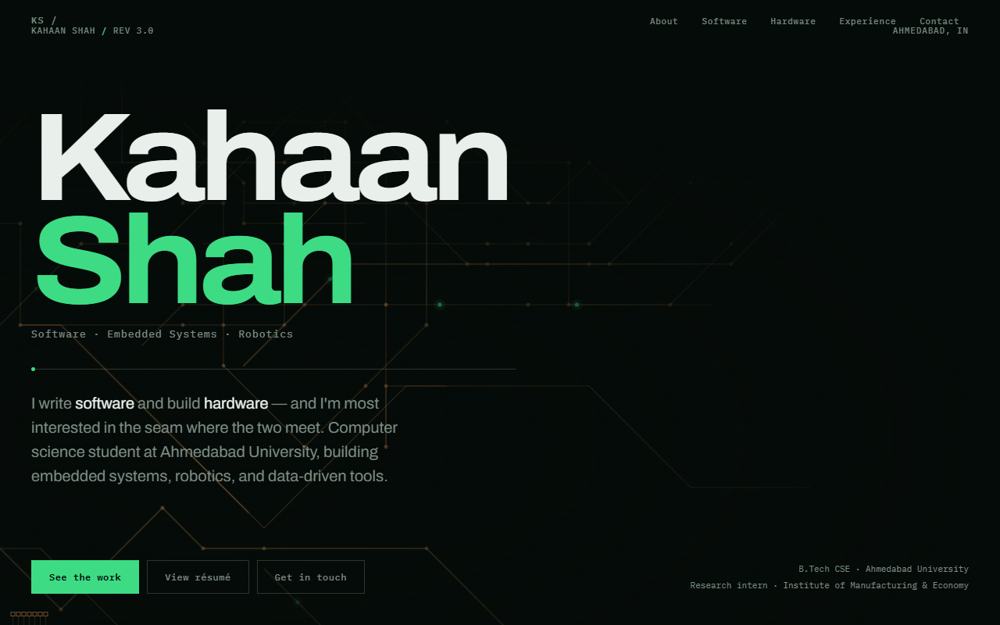

<div align="center">

# ⚡ Kahaan Shah — Engineering Portfolio

<p><strong>Hardware Meets Software: Embedded Systems, Robotics, Control Systems & Full-Stack Tools.</strong></p>

[](https://kahaanshah.in)
[](https://kahaanshah.in)
[](https://kahaanshah.in)
[](LICENSE)

<br />

<a href="https://kahaanshah.in">
  
</a>

<br /><br />

[**Explore Live Experience ↗**](https://kahaanshah.in) · [**Report Issue**](https://github.com/Kahaan83/portfolio_website/issues)

</div>

---

## 🎯 About The Project

This is the source code for my personal portfolio ([**kahaanshah.in**](https://kahaanshah.in)). 

Rather than relying on cookie-cutter templates or heavy multi-megabyte JavaScript frameworks, the site is hand-crafted with zero runtime dependencies. It is themed around a **PCB / circuit-board design aesthetic**—reflecting my dual passion for low-level embedded hardware and responsive web applications.

### 🌟 Key Highlights

- **⚡ Zero-Framework Performance:** 100% vanilla HTML5, custom property CSS, and vanilla JS. Loads near-instantaneously with zero compilation or hydration delays.
- **🎨 Hardware Aesthetic:** Custom PCB design tokens (`--board`, `--mask`, `--copper`, `--signal`) that emulate a dark soldermask and copper traces.
- **🕹️ Interactive 3D Canvas:** Custom interactive rendering showcasing project models (such as the PID Line Follower robot) directly in the browser.
- **⚡ Reactive Circuit Traces:** Dynamic canvas-driven background trace lines with animated electrical signal pulses that react to user interaction.
- **♿ Accessible & Semantic:** Includes accessible skip links, visible focus indicators, `prefers-reduced-motion` compliance, and semantic landmark elements.
- **🔍 Search Engine Optimized:** Complete Schema.org JSON-LD Person structured data, canonical tags, Open Graph meta images, and Twitter Cards.

---

## 🛠️ Tech Stack

| Layer | Technology |
|---|---|
| **Core Architecture** | Pure HTML5 · Modern CSS3 (CSS Variables, Flexbox, Grid) · Vanilla ES6+ |
| **Typography** | [Archivo](https://fonts.google.com/specimen/Archivo) (Display) · [IBM Plex Mono](https://fonts.google.com/specimen/IBM+Plex+Mono) (Code & Metrics) |
| **Graphics & Animation** | HTML5 2D Canvas · WebGL / Three.js 3D Viewers · CSS Animations |
| **Deployment & Hosting** | [Vercel](https://vercel.com) (Continuous Deployment from `main`) |
| **SEO & Social** | JSON-LD Structured Data · OpenGraph · Twitter Card |

---

## 📂 Repository Structure

```bash
portfolio_website/
├── index.html       # Single-file architecture: markup, styles, & interactive scripts
├── vercel.json      # Routing, clean URLs, and HTTP caching headers
├── assets/          # Project screenshots, preview graphics, and diagrams
└── README.md        # Documentation and setup guide
```

---

## 🚀 Running Locally

No package managers, bundling tools, or build steps required.

1. **Clone the repository:**
   ```bash
   git clone https://github.com/Kahaan83/portfolio_website.git
   cd portfolio_website
   ```

2. **Serve with any local static HTTP server:**
   ```bash
   # Using Python 3:
   python -m http.server 3000

   # Or using Node.js / npx:
   npx serve .
   ```

3. Open **`http://localhost:3000`** in your browser.

---

## 🌐 Featured Works Displayed

The portfolio showcases end-to-end engineering projects across multiple domains:

| Category | Featured Projects |
|---|---|
| **Embedded & Robotics** | • [**Self-Balancing Robot**](https://github.com/Kahaan83/Self-Balancing-robot) (PID + Kalman filter, 1st place university award)<br>• [**Biomechanical Throw Tracker**](https://github.com/Kahaan83/Biomechanical-throw-tracker) (ESP32 + EMG + IMU glove)<br>• [**PID Line Follower**](https://github.com/Kahaan83/Line-follower) (5-sensor IR array + dynamic motor mixing) |
| **Web & Edge AI** | • [**WebGPU Private AI Chat**](https://github.com/Kahaan83/webgpu-llm-chat) (100% on-device browser LLM inference)<br>• [**Blaze Reader**](https://github.com/Kahaan83/Blaze-reader) (RSVP speed reader with AI recall checks)<br>• [**The Addams Mansion Escape Room**](https://github.com/Kahaan83/escape-room-website) (Interactive browser game with Web Audio API) |
| **Data Pipelines** | • [**IME Economic Data Pipeline**](https://github.com/Kahaan83/ime-data-pipeline) (Multi-year trade & financial analytics engine) |

---

## 📬 Connect

- **Portfolio:** [kahaanshah.in](https://kahaanshah.in)
- **LinkedIn:** [linkedin.com/in/kahaan-shah-842095334](https://www.linkedin.com/in/kahaan-shah-842095334/)
- **Email:** [kahaanshah83@gmail.com](mailto:kahaanshah83@gmail.com)

---

## 📄 License

This project is licensed under the MIT License — see the [LICENSE](LICENSE) file for details.